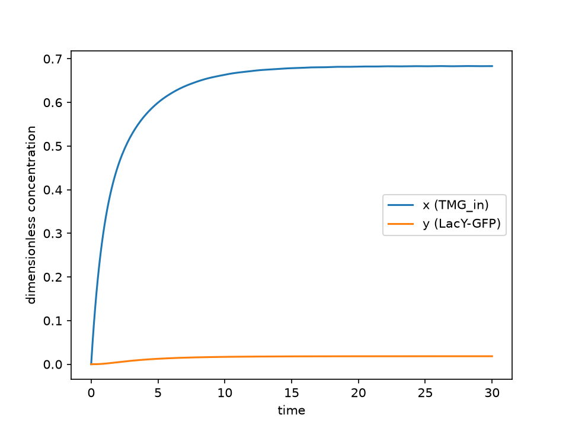
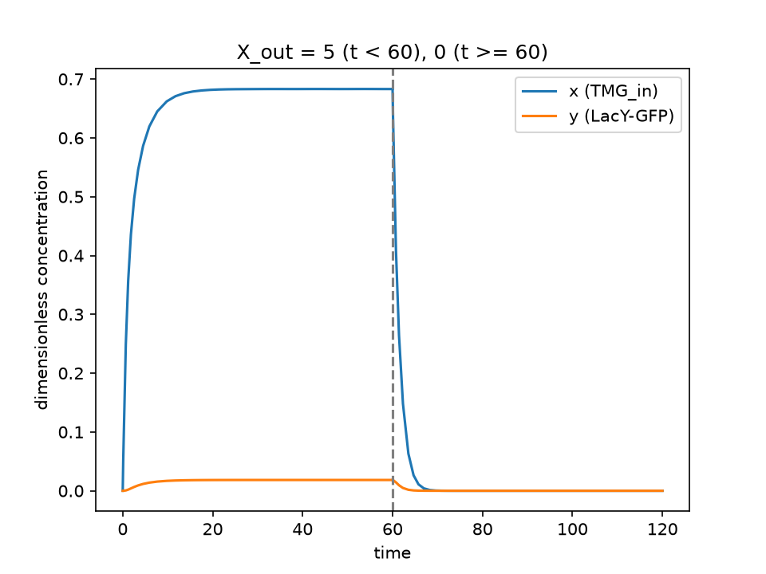
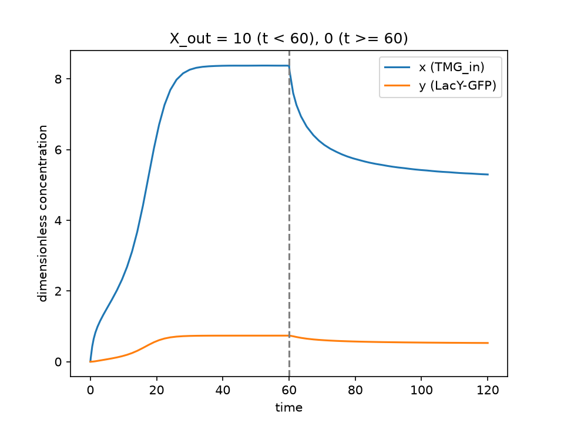
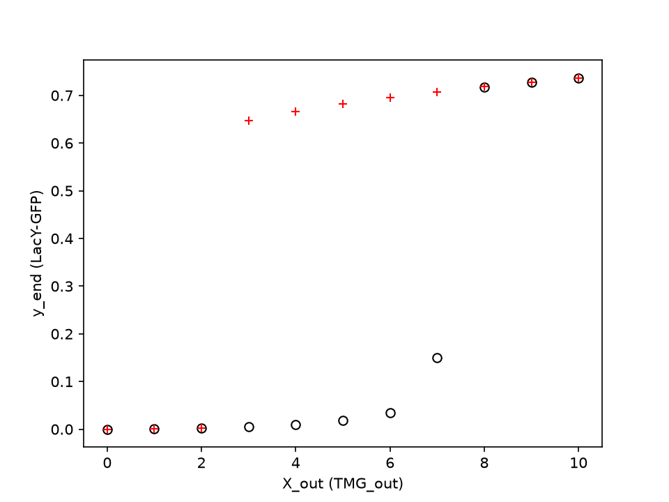
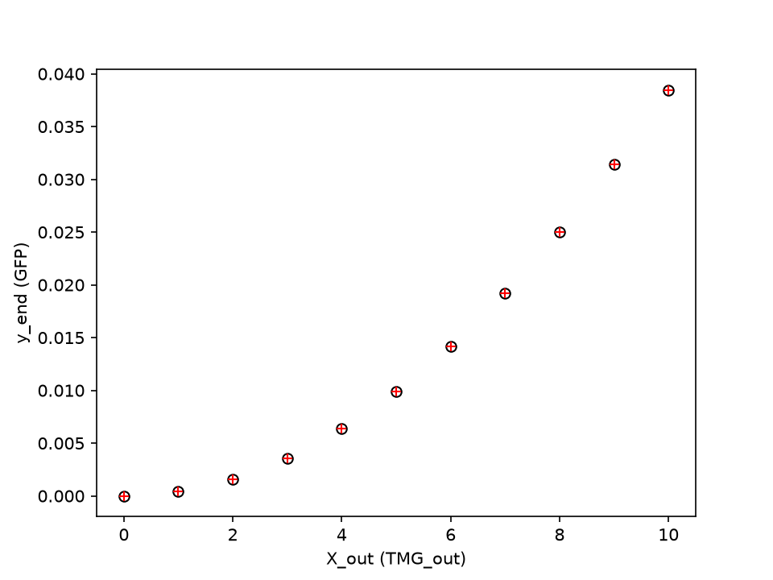

学籍番号 \_\_\_\_\_\_\_\_\_\_\_\_\_\_\_\_\_\_　氏名 \_\_\_\_\_\_\_\_\_\_\_\_\_\_\_\_\_\_\_\_\_\_

## 対象とするモデル

Ozbudak et al. (2004) のモデル（講義で用いた簡略版）を扱う。

$$
\frac{dx}{dt} = -x + \alpha X_{\mathrm{out}} + \beta y, \qquad
\frac{dy}{dt} = \frac{x^2}{\rho + x^2} - y
$$

$x$ は細胞内の TMG（TMG$_{\mathrm{in}}$），$y$ は LacY-GFP，$X_{\mathrm{out}}$ は培地の TMG（TMG$_{\mathrm{out}}$）の濃度である。
定数は講義と同じく $\alpha = 0.1$，$\beta = 10$，$\rho = 25$ とした。
数値解は `scipy.integrate.solve_ivp`（RK45）で求めた。

## 演習1: Ozbudak モデルの数値解

空欄には上の微分方程式の右辺をそのまま書く。

```python
dxdt = -x + (alpha * x_out) + (beta * y)
dydt = x**2 / (rho + x**2) - y
```

初期値 $x(0) = y(0) = 0$，$X_{\mathrm{out}} = 5$ で $t = 0$〜$30$ を解いた結果を図1に示す。
$x$ は約 $0.683$，$y$ は約 $0.018$ で一定になる。講義資料の出力例と一致した。

{width=50%}

## 演習2: ヒステリシスの確認（時系列）

前半（$t = 0$〜$60$）の終端値を後半の初期値に引き継ぎ，後半（$t = 60$〜$120$）では培地の TMG を 0 にする。

```python
x_init = TMG[ -1 ]    # TMG の終端値を x_init にセット
y_init = LacY[ -1 ]   # LacY の終端値を y_init にセット
x_out = 0             # TMGout の値を 0 にする
```

$X_{\mathrm{out}}$ の初期値を 5 と 10 の 2 通りで試した結果を下に示す。

{width=49%} {width=49%}

左: $X_{\mathrm{out}} = 5$，右: $X_{\mathrm{out}} = 10$（破線は $t = 60$）

- $X_{\mathrm{out}} = 5$ のとき，前半で $y$ は約 $0.018$ にとどまり，$X_{\mathrm{out}} = 0$ にすると $y$ は 0 に戻る。ヒステリシスは生じない。
- $X_{\mathrm{out}} = 10$ のとき，前半で $y$ は約 $0.737$ まで上がり，$X_{\mathrm{out}} = 0$ にしても $y$ は $t = 120$ で約 $0.53$ を保つ。培地の TMG がなくなっても誘導された状態が残り，ヒステリシスが生じる。
- 初期値を 1 ずつ変えると，$X_{\mathrm{out}} \le 7$ ではヒステリシスなし，$X_{\mathrm{out}} \ge 8$ ではヒステリシスありとなり，講義資料と一致した。

$X_{\mathrm{out}} = 7$ は境目に近い。$t = 60$ の時点で $y = 0.144$ とまだ上がりきっておらず，そのまま $X_{\mathrm{out}} = 7$ で解き続けると $t = 100$ で $y \approx 0.706$ に達する。
境目の近くでは状態の切り替わりに時間がかかるため，前半の長さ 60 の中で切り替わるかどうかで結果が分かれる。

## 演習3: ヒステリシスの可視化（用量反応曲線）

$X_{\mathrm{out}}$ を 0 から 10 まで 1 ずつ増やし，続けて 10 から 0 まで 1 ずつ減らす。
各ステップでは $t = 0$〜$60$ を解き，$y$ の終端値を次のステップの初期値に渡す。$x$ は毎回 0 に戻す（集菌で $x$ はリセットされ，$y$ は保存される）。
空欄は次のとおり。

```python
y_end = LacY[ -1 ]    # LacY の時系列の最終値
return y_end          # 次のシミュレーションの初期値にする

for x_out in reversed( range(11) ):
    y_init = ozbudak_dose_response( x_out , y_init , 'r+' )
```

{width=50%}

- 増加させる場合（○），$y_{\mathrm{end}}$ は $X_{\mathrm{out}} \le 6$ で $0.034$ 以下にとどまり，$X_{\mathrm{out}} = 8$ で $0.718$ に跳び上がる（$X_{\mathrm{out}} = 7$ は演習2で述べた理由で途中の $0.15$）。
- 減少させる場合（+），$y_{\mathrm{end}}$ は $X_{\mathrm{out}} = 3$ まで $0.647$ 以上を保ち，$X_{\mathrm{out}} = 2$ で 0 付近に落ちる。
- $X_{\mathrm{out}} = 3$〜$7$ では，同じ $X_{\mathrm{out}}$ でも履歴によって $y_{\mathrm{end}}$ が 2 通りに分かれる。Ozbudak et al. (2004) Fig. 2b と同じ形のヒステリシスが再現でき，講義資料の出力例とも一致した。

## 演習4: ポジティブ・フィードバックの遮断

### 1. 改変する項

$dx/dt$ の第3項 $\beta y$ は，LacY が TMG を細胞内に取り込む効果を表す。
$y$（LacY）が増えると $x$（TMG$_{\mathrm{in}}$）が増え，$x$ が増えると LacI による抑制が外れて $y$ が増える。このループがポジティブ・フィードバックである。
$\beta y$ を取り除く（$\beta = 0$ とする）と，$y$ は $x$ に影響しなくなり，ループが切れる。

$$
\frac{dx}{dt} = -x + \alpha X_{\mathrm{out}}, \qquad
\frac{dy}{dt} = \frac{x^2}{\rho + x^2} - y
$$

このとき $y$ は TMG を取り込まないレポーター（GFP）の量を表す（講義資料の「GFP (y)」の図に対応）。

### 2. シミュレーション

演習3と同じ手順で用量反応曲線を描いた（図3）。

```python
dxdt = -x + alpha * x_out
dydt = x**2 / ( rho + x**2 ) - y
```

{width=50%}

増加（○）と減少（+）の点が完全に重なり，ヒステリシスは生じない。
定常状態は $x^* = \alpha X_{\mathrm{out}}$，$y^* = x^{*2}/(\rho + x^{*2})$ の 1 つだけで，$X_{\mathrm{out}} = 10$ でも $y^* = 1/26 \approx 0.0385$ にとどまる。講義資料の図（最大値約 $0.038$）と一致した。
