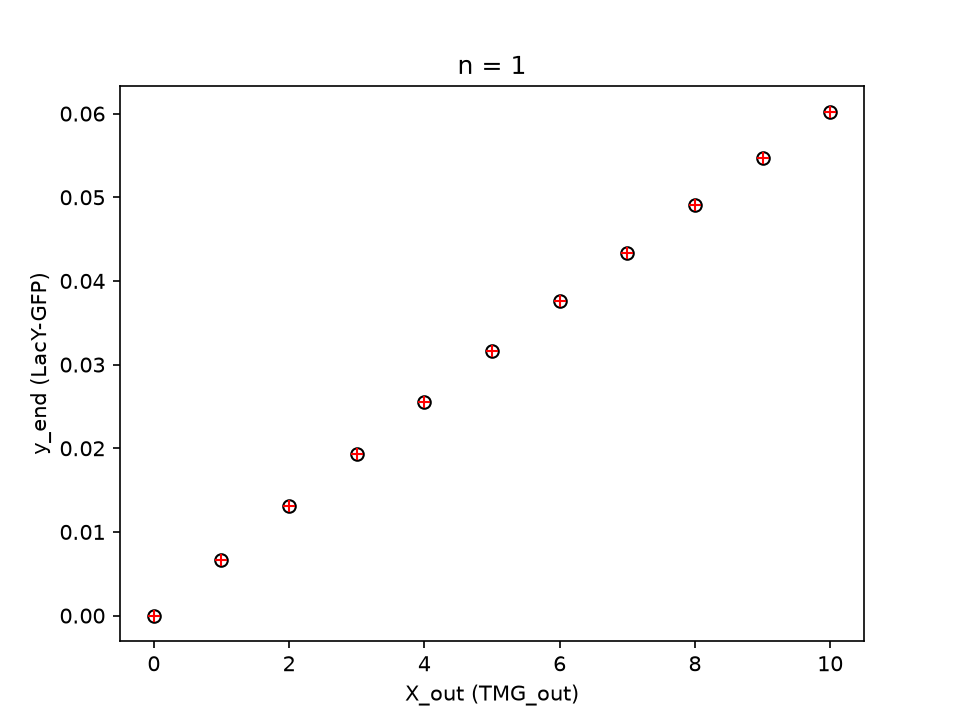
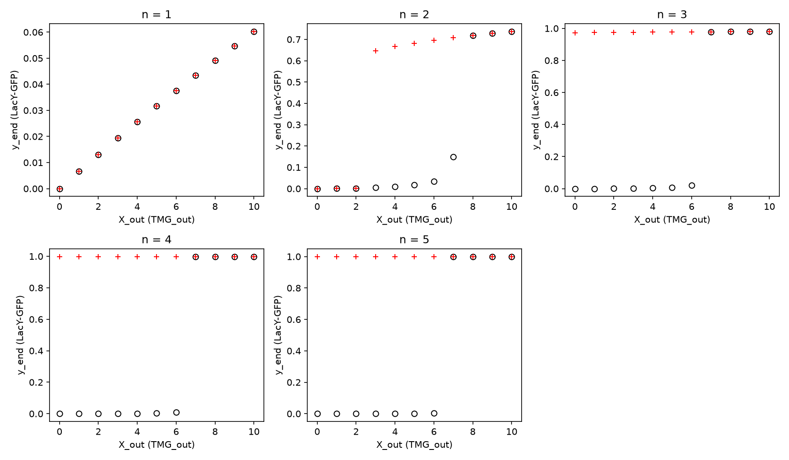
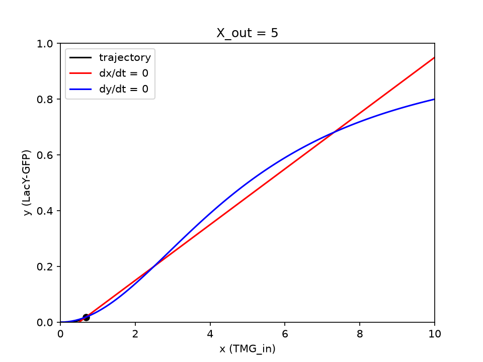
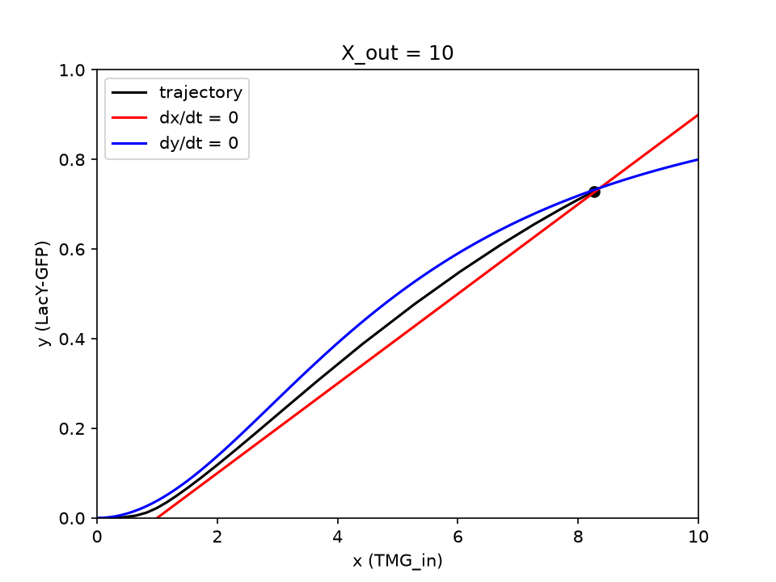
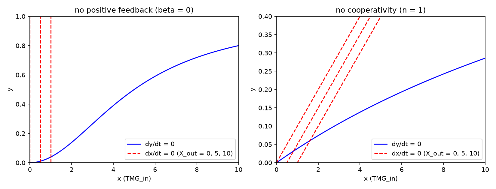
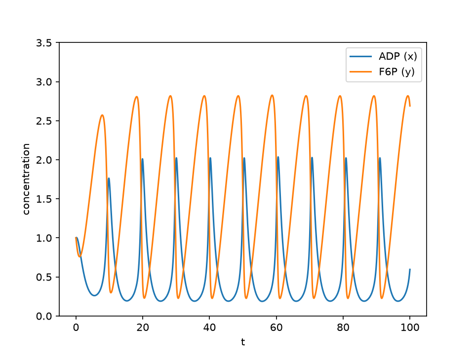
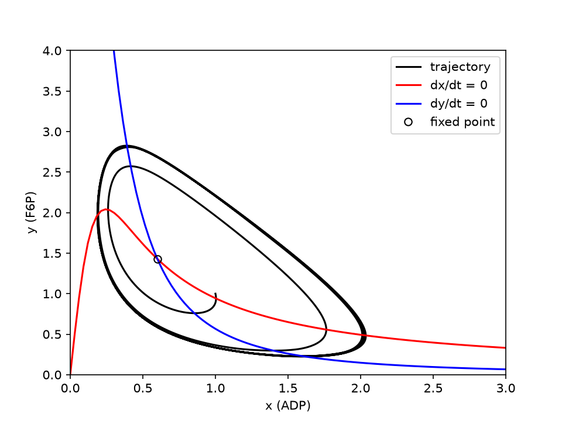

学籍番号 \_\_\_\_\_\_\_\_\_\_\_\_\_\_\_\_\_\_　氏名 \_\_\_\_\_\_\_\_\_\_\_\_\_\_\_\_\_\_\_\_\_\_

第2回の演習5・6と，第3回の演習1・2をまとめる。
数値解はいずれも `scipy.integrate.solve_ivp`（RK45）で求めた。

# 第2回の続き: 双安定性とヒステリシス

## 対象とするモデル

第2回と同じ Ozbudak et al. (2004) のモデル（講義で用いた簡略版）で，$dy/dt$ の Hill 係数を $n$ とおく。

$$
\frac{dx}{dt} = -x + \alpha X_{\mathrm{out}} + \beta y, \qquad
\frac{dy}{dt} = \frac{x^n}{\rho + x^n} - y
$$

$x$ は TMG$_{\mathrm{in}}$，$y$ は LacY-GFP，$X_{\mathrm{out}}$ は TMG$_{\mathrm{out}}$ の濃度である。
講義のモデルは $n = 2$ にあたる。定数は $\alpha = 0.1$，$\beta = 10$，$\rho = 25$ とした。

## 演習5: Hill 係数とヒステリシスの関係

用量反応曲線は第2回の演習3と同じ手順で描いた。
$X_{\mathrm{out}}$ を 0 から 10 まで 1 ずつ増やし（○），続けて 10 から 0 まで 1 ずつ減らす（+）。
各ステップでは $t = 0$〜$60$ を解き，$y$ の終端値を次のステップの初期値に渡す。$x$ は毎回 0 に戻す。
モデルの改変は $dy/dt$ の指数を $n$ にするだけである。

```python
dydt = x**n / ( rho + x**n ) - y
```

### 1. Hill 係数を 1 にしたモデル

{width=42%}

増加（○）と減少（+）の点が完全に重なり，ヒステリシスは生じない（図1）。
$y_{\mathrm{end}}$ は $X_{\mathrm{out}}$ とともにほぼ直線的に増え，$X_{\mathrm{out}} = 10$ でも $0.060$ にとどまる。
ポジティブ・フィードバックは残っているが，協同性がないと $X_{\mathrm{out}} \le 10$ の範囲では LacY が強く誘導された状態は現れない（定常状態の $y$ は $X_{\mathrm{out}} = 100$ でも約 $0.35$）。
定常状態が 1 つしかない理由は演習6で相平面を使って示す。

### 2. Hill 係数を 1〜5 にした場合

$n = 1, 2, 3, 4, 5$ で同じ用量反応曲線を描いた（図2）。

{width=82%}

定常状態は，$dx/dt = 0$ から得る $y = (x - \alpha X_{\mathrm{out}})/\beta$ を $dy/dt = 0$ に代入した

$$
x^{n+1} - (\alpha X_{\mathrm{out}} + \beta)\, x^n + \rho x - \rho \alpha X_{\mathrm{out}} = 0
$$

の実根のうち $x \ge \alpha X_{\mathrm{out}}$（$y \ge 0$）を満たすものである。
$X_{\mathrm{out}}$ を $0$〜$10$ の範囲で $0.001$ 刻みに変えて根の数を数え，定常状態が 3 つになる範囲を求めた。

\vspace{0pt plus 14\baselineskip}\penalty-250\vspace{0pt plus -14\baselineskip}

| $n$ | 増加で跳び上がる $X_{\mathrm{out}}$ | 減少で落ちる $X_{\mathrm{out}}$ | 高い状態の $y_{\mathrm{end}}$ | 定常状態が 3 つの範囲 |
|:-:|:-:|:-:|:-:|:-:|
| 1 | なし | なし | なし | なし |
| 2 | 8 | 2 | $0.647$〜$0.737$ | $0 < X_{\mathrm{out}} < 6.74$ |
| 3 | 7 | 0 まで落ちない | $0.974$〜$0.981$ | $0 \le X_{\mathrm{out}} < 6.18$ |
| 4 | 7 | 0 まで落ちない | $0.997$〜$0.998$ | $0 \le X_{\mathrm{out}} < 6.46$ |
| 5 | 7 | 0 まで落ちない | $1.000$ | $0 \le X_{\mathrm{out}} < 6.76$ |

- ヒステリシスが生じないのは $n = 1$ だけで，$n \ge 2$ では増加と減少で経路が分かれる。
- $n$ が大きいほど，低い状態は 0 に，高い状態は 1 に近づく。$X_{\mathrm{out}} = 6$ の低い状態の $y_{\mathrm{end}}$ は $n = 2$〜$5$ で $0.034$，$0.020$，$0.009$，$0.004$ と下がる。切り替えが急になり，ON と OFF の差がはっきりする。
- 増加させたときに跳び上がる $X_{\mathrm{out}}$ は $n$ によらず 7〜8 である（$n = 2$ の $X_{\mathrm{out}} = 7$ は切り替えの途中で $0.15$）。定常状態が 3 つある範囲の上端（$6.2$〜$6.8$）を超えると低い状態が消え，高い状態へ移るためである。
- $n \ge 3$ では $X_{\mathrm{out}} = 0$ まで下げても高い状態が保たれ，この手順では一度誘導されると元に戻らない。$X_{\mathrm{out}} = 0$ でも定常状態が 3 つ（$n = 3$ で $x = 0,\ 1.74,\ 9.74$）あって高い状態が残り，さらに $x$ を 0 に戻した点 $(0, y_{\mathrm{end}})$ から出た解がその高い状態に引き込まれるためである。
- $n = 2$ では $X_{\mathrm{out}} = 0$ のとき高い状態が $x(x-5)^2 = 0$ の重根になり，ちょうど消える境目にあたる。用量反応曲線で $X_{\mathrm{out}} = 2$ で落ちたのは，$x$ を 0 に戻す手順のため $(0, y)$ から出発した解が低い状態に引き込まれたからで，定常状態としての高い状態は $X_{\mathrm{out}} = 2$ にも存在する（$x \approx 6.4$）。

以上から，調べた整数の $n$ ではヒステリシスに協同性（$n \ge 2$）が必要である。$n$ を実数で振ると，この定数では $n \approx 1.8$ 以上で，$X_{\mathrm{out}} \le 10$ の中に定常状態が 3 つになる範囲が現れる。
$n$ を大きくするとスイッチが急になり，この手順では $n \ge 3$ で誘導された状態が戻らなくなる。

## 演習6: 相平面とヌルクライン

### 1. 解の軌跡

空欄は次のとおり（$n = 2$）。

```python
plt.plot( TMG , LacY , 'k-' )      # 解の軌跡を描く
y_null = x**2 / ( rho + x**2 )     # dy/dt = 0 のヌルクライン
```

初期値 $x(0) = y(0) = 0$ で $t = 0$〜$30$ を解き，$x$-$y$ 平面に描いた。
$X_{\mathrm{out}}$ は，第2回の演習2の手順でスイッチが入らない値 5 と，入る値 10 を試した。

{width=49%} {width=49%}

左: $X_{\mathrm{out}} = 5$，右: $X_{\mathrm{out}} = 10$（黒線が解の軌跡，● が終点，赤が $dx/dt = 0$，青が $dy/dt = 0$）

- $X_{\mathrm{out}} = 5$ のとき，2 本のヌルクラインは $(0.683, 0.018)$，$(2.50, 0.200)$，$(7.32, 0.682)$ の 3 点で交わる。原点から出た軌跡は最も低い交点 $(0.683, 0.018)$ で止まり，第2回の演習1の定常値と一致する。
- $X_{\mathrm{out}} = 10$ のとき，交点は $(8.37, 0.737)$ の 1 つだけになる。軌跡は 2 本のヌルクラインの間を右上へ進み，この交点に近づく（$t = 30$ の終点は $(8.25, 0.729)$）。第2回の演習2で $y$ が約 $0.737$ まで上がったことに対応する。

時系列が定常状態に達することは，相平面では軌跡が固定点（ヌルクラインの交点）に達することにあたる。

### 2. ヌルクラインの式

$dx/dt = 0$ とおくと

$$
-x + \alpha X_{\mathrm{out}} + \beta y = 0 \quad\Longrightarrow\quad y = \frac{x - \alpha X_{\mathrm{out}}}{\beta}
$$

で，傾き $1/\beta = 0.1$，$x$ 切片 $\alpha X_{\mathrm{out}}$ の直線である（赤）。$X_{\mathrm{out}}$ を大きくすると右へ平行移動する。

$dy/dt = 0$ とおくと

$$
\frac{x^2}{\rho + x^2} - y = 0 \quad\Longrightarrow\quad y = \frac{x^2}{\rho + x^2}
$$

で，$x = \sqrt{\rho/3} \approx 2.89$ に変曲点をもつ S 字の曲線である（青）。

直線と S 字の曲線は最大 3 点で交わる。交点が 3 つあるとき，解は両端の交点のどちらかに落ち着き，中央の交点が分かれ目になる。これが双安定性である。
$X_{\mathrm{out}}$ を増やすと直線が右へ動き，$X_{\mathrm{out}} \approx 6.74$ で低い交点と中央の交点が合わさって消える。解は高い交点へ移るしかない。
その後 $X_{\mathrm{out}}$ を減らしても高い交点は残るので，$y$ は高いままになる。これがヒステリシスである。

ポジティブ・フィードバックを除いた場合（演習4，$\beta = 0$）と協同性を除いた場合（演習5，$n = 1$）のヌルクラインを図3に示す（$X_{\mathrm{out}} = 0, 5, 10$）。

{width=85%}

- $\beta = 0$ では $dx/dt = 0$ が縦線 $x = \alpha X_{\mathrm{out}}$ になり，S 字の曲線と必ず 1 点で交わる。固定点は 1 つで，ヒステリシスは生じない。
- $n = 1$ では $dy/dt = 0$ が $y = x/(\rho + x)$ となり，全域で上に凸である。差 $h(x) = x/(\rho + x) - (x - \alpha X_{\mathrm{out}})/\beta$ も上に凸で，$h(\alpha X_{\mathrm{out}}) > 0$（$X_{\mathrm{out}} > 0$ のとき），$x \to \infty$ で $h \to -\infty$ なので，$x \ge \alpha X_{\mathrm{out}}$ で $h = 0$ となる点は 1 つしかない（$X_{\mathrm{out}} = 0$ では原点のみ）。固定点は 1 つで，ヒステリシスは生じない。

ポジティブ・フィードバックは $dx/dt = 0$ を傾いた直線にし，協同性は $dy/dt = 0$ を S 字にする。
両方がそろって初めて交点が 3 つでき，双安定性とヒステリシスが生じる。

# 第3回: 濃度が振動する生化学反応系

## 対象とするモデル

解糖系の振動を表す Sel'kov モデル（Strogatz 1994）を扱う。

$$
v_1 = b, \qquad v_2 = a y + x^2 y, \qquad v_3 = x
$$

$$
\frac{dx}{dt} = v_2 - v_3 = -x + a y + x^2 y, \qquad
\frac{dy}{dt} = v_1 - v_2 = b - a y - x^2 y
$$

$x$ は ADP，$y$ は F6P の濃度である。$v_2$ は PFK の反応で，生成物の ADP が PFK を活性化するポジティブ・フィードバックを $x^2 y$ の項が表す。
パラメータは $a = 0.06$，$b = 0.6$，初期値は $x(0) = y(0) = 1.0$，時間は $t = 0$〜$100$ とした。

## 演習1: Sel'kov モデルの数値解

空欄には各反応の速度式を書く。

```python
v1 = b
v2 = a * y + x**2 * y
v3 = x
```

{width=52%}

- ADP と F6P はともに減衰せずに振動し続ける（図4）。ADP の最初のスパイクは $t \approx 9.85$ で，スパイクの間隔は最初が $10.06$，その後は $10.15$〜$10.17$（周期 $\approx 10.16$）にそろう。$t > 40$ での振れ幅は ADP が $0.19$〜$2.04$，F6P が $0.23$〜$2.83$ で，講義資料の出力例と一致した。これは講義のコードと同じ `solve_ivp` の既定の許容誤差での値で，許容誤差を `rtol=1e-9` まで厳しくすると上端は ADP が $2.02$，F6P が $2.81$ になる。
- 1 周期の中では，F6P がゆっくり増えたあと ADP が鋭く立ち上がり，同時に F6P が急に減る。F6P がたまると $x^2 y$ の項で ADP の生成が加速し，増えた ADP がさらに PFK を活性化する。F6P が減ると ADP の生成が遅くなり，ADP は下流の反応 $v_3 = x$ で消費されて減る。F6P は一定の流入 $v_1 = b$ によって再び蓄積する。

## 演習2: 相平面とヌルクライン

### 1. 解の軌跡

空欄は次のとおり。

```python
plt.plot( ADP , F6P , 'k-' )       # 解の軌跡を描く
y_null = b / ( a + x**2 )          # dy/dt = 0 のヌルクライン
plt.plot( x , y_null , 'b-' )      # dy/dt = 0 のヌルクラインを描画
```

講義資料のコードでは `x_null` と `y_null` のコメントがどちらも「dydt」となっているが，`x_null = x / ( a + x**2 )` は下で導くとおり $dx/dt = 0$ のヌルクラインである。

{width=50%}

軌跡は $(1.0, 1.0)$ から出発し，固定点のまわりを時計回りに回りながら外側へ広がる（図5）。
2 周目以降は 1 本の閉じた軌道に重なり，その上を回り続ける。これは時系列で周期約 $10.16$ の振動が続くことに対応する。

### 2. ヌルクラインの式

$dx/dt = 0$ とおくと

$$
-x + a y + x^2 y = 0 \quad\Longrightarrow\quad y\,(a + x^2) = x \quad\Longrightarrow\quad y = \frac{x}{a + x^2}
$$

である（赤）。原点を通り，$x = \sqrt{a} \approx 0.245$ で最大値 $1/(2\sqrt{a}) \approx 2.04$ をとる山形の曲線になる。

$dy/dt = 0$ とおくと

$$
b - a y - x^2 y = 0 \quad\Longrightarrow\quad y = \frac{b}{a + x^2}
$$

である（青）。$x = 0$ で $b/a = 10$ をとり，$x$ とともに単調に減る。

2 式を等しくおくと $x = b$ となるので，固定点は

$$
(x^*, y^*) = \left( b,\ \frac{b}{a + b^2} \right) = (0.6,\ 1.43)
$$

の 1 つだけである。

- 軌跡は赤の曲線を縦向きに，青の曲線を横向きに横切る。閉じた軌道の左端（$x \approx 0.19$）は赤の曲線上に，上端（$y \approx 2.81$）は青の曲線上にある。
- 第2回の Ozbudak モデルでは軌跡が固定点に達して止まったが，Sel'kov モデルの軌跡は唯一の固定点に近づかず，そのまわりを回り続ける。固定点は不安定で，その外側に閉じた軌道（リミットサイクル）があると考えられる。固定点の安定性は演習4以降で調べる。
