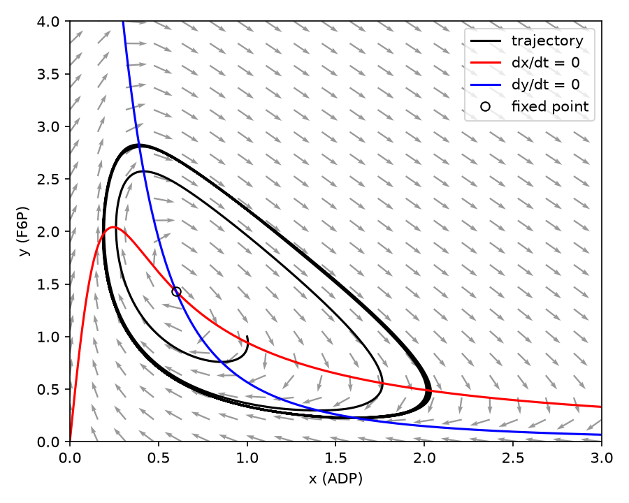
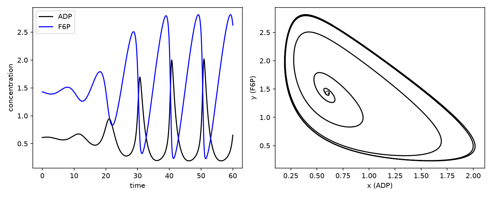

学籍番号 \_\_\_\_\_\_\_\_\_\_\_\_\_\_\_\_\_\_　氏名 \_\_\_\_\_\_\_\_\_\_\_\_\_\_\_\_\_\_\_\_\_\_

第3回の演習3〜5と，第4回の演習6をまとめる。
第3回の資料には「演習4」が 2 つあるので，固定点の座標を求めるものを演習4-1，線形化を演習4-2 と呼ぶ。
第3回の演習5と第4回の演習6は同じ問題（固定点の分類）なので，1 つの節で答える。
数値解はいずれも `scipy.integrate.solve_ivp`（RK45），記号計算は SymPy で求めた。

# 対象とするモデル

第3回の宿題と同じ Sel'kov モデルを扱う。

$$
\frac{dx}{dt} = f(x, y) = -x + a y + x^2 y, \qquad
\frac{dy}{dt} = g(x, y) = b - a y - x^2 y
$$

$x$ は ADP，$y$ は F6P の濃度である。パラメータは $a = 0.06$，$b = 0.6$ とした。
ヌルクラインは $dx/dt = 0$ が $y = x/(a + x^2)$（赤），$dy/dt = 0$ が $y = b/(a + x^2)$（青）である。

# 演習3: Sel'kov モデルのベクトル場

## 1. ベクトル場の描画

空欄は次のとおり。

```python
v1 = b
v2 = a * Y + X**2 * Y
v3 = X
plt.quiver( X , Y , dxdt , dydt )        # 点(X,Y)に大きさ(dxdt,dydt)の矢印を描く
plt.streamplot( X , Y , dxdt , dydt )    # 微分方程式が定める「流れ」を可視化する
```

速度式には `meshgrid` で作った 2 次元の `X`，`Y` を使う。1 次元の `x`，`y`（10 点）を使うと `dxdt` の形が格子（$10 \times 10$ 点）と合わず，`quiver` がエラーになる。
講義のコードどおり $0 \le x \le 3$，$0 \le y \le 10$ を $10 \times 10$ の格子に区切った（図1）。

{width=95%}

- `quiver` の矢印の長さは速さ $\sqrt{(dx/dt)^2 + (dy/dt)^2}$ に比例する。右上ほど $x^2 y$ の項が大きくなり，矢印は長く，右下 45° を向く。2 式を足すと $dx/dt + dy/dt = b - x$ となり，$x^2 y$ が大きいところでは $dx/dt \approx -dy/dt$ になるためである。F6P が ADP に変わる反応 $v_2$ が速く進むことを表す。
- 固定点 $(0.6, 1.43)$ の近くでは矢印が短すぎて，`quiver` では向きが読み取れない。
- `streamplot` では，上から来た流れが右下へ下り，下側を左へ戻り，左側を上る。固定点のまわりを時計回りに回る流れが見える。

## 2. ヌルクライン・解の軌跡との重ね描き

第3回の演習2の図（初期値 $(1.0, 1.0)$，$t = 0$〜$100$）にベクトル場を重ねた（図2）。
そのままの矢印では右上の長い矢印に埋もれるので，矢印の長さをそろえて向きだけを描き，範囲を $0 \le y \le 4$，格子を $20 \times 20$ にした。

{width=62%}

$dx/dt = -x + y\,(a + x^2)$ は $y$ について増加，$dy/dt = b - y\,(a + x^2)$ は $y$ について減少するので，赤の曲線より上で $dx/dt > 0$，青の曲線より上で $dy/dt < 0$ である。
また $x < b$ では青の曲線が赤の曲線より上に，$x > b$ では下にある。2 本のヌルクラインは固定点のまわりを 4 つの領域に分ける。

| 固定点から見た位置 | 領域 | $dx/dt$ | $dy/dt$ | 矢印の向き |
|:-:|:-:|:-:|:-:|:-:|
| 上 | 赤と青の両方より上 | $+$ | $-$ | 右下 |
| 右 | 赤より下，青より上（$x > b$） | $-$ | $-$ | 左下 |
| 下 | 赤と青の両方より下 | $-$ | $+$ | 左上 |
| 左 | 赤より上，青より下（$x < b$） | $+$ | $+$ | 右上 |

- 上 → 右 → 下 → 左の順に右下，左下，左上，右上を向くので，流れは固定点のまわりを時計回りに回る。解の軌跡が時計回りに回ることと一致する。
- 赤の曲線上では $dx/dt = 0$ なので矢印は真上か真下を，青の曲線上では $dy/dt = 0$ なので真右か真左を向く。軌跡も赤の曲線を縦に，青の曲線を横に横切る。
- ただし，ベクトル場からわかるのは固定点のまわりを回ることまでである。軌跡が内側へ巻き込んで固定点に収束するのか，閉じた軌道に落ち着くのかは，矢印の向きだけでは区別できない。これを固定点の安定性（演習4・5）で調べる。

# 演習4-1: 固定点の座標

2 本のヌルクラインの交点を求める。空欄は次のとおり。

```python
solutions = sp.solve( [ x/(a+x**2) - y , b/(a+x**2) - y ] , ( x , y ) )
```

出力は `[(0.600000000000000, 1.42857142857143)]` で，固定点は $(x^*, y^*) = (0.6,\ 1.43)$ の 1 つだけである。
第3回の宿題で手計算した $(b,\ b/(a + b^2)) = (0.6,\ 0.6/0.42)$ と一致する。
$dx/dt + dy/dt = b - x$ なので固定点では必ず $x = b$ となり，ヌルクラインの式を使わず $f = g = 0$ を直接解いても固定点はこの 1 つしかない。

# 演習4-2: Sel'kov モデルの線形化

空欄は次のとおり（`selkov_jacobian.py`）。

```python
g = b - a * y - x**2 * y
solutions = sp.solve( [ f , g ] , ( x , y ) )
J_sym = sp.Matrix( [ [ f.diff( x ) , f.diff( y ) ] , [ g.diff( x ) , g.diff( y ) ] ] )
J_num = J_sym.subs( [ ( x , fix_x ) , ( y , fix_y ) , ( a , a_val ), ( b , b_val ) ] )
print( J_num.eigenvals() )
```

`solve` は記号のまま解かせると `[(b, b/(a + b**2))]` を返す。

## 1. 線形化

$f$，$g$ を $x$，$y$ で偏微分すると

$$
J(x, y) =
\begin{pmatrix}
\dfrac{\partial f}{\partial x} & \dfrac{\partial f}{\partial y} \\[2ex]
\dfrac{\partial g}{\partial x} & \dfrac{\partial g}{\partial y}
\end{pmatrix}
=
\begin{pmatrix}
-1 + 2xy & a + x^2 \\
-2xy & -(a + x^2)
\end{pmatrix}
$$

となる。プログラムの出力 `Matrix([[2*x*y - 1, a + x**2], [-2*x*y, -a - x**2]])` と一致する。

## 2. 固定点でのヤコビ行列

固定点では $x^* y^* = b^2/(a + b^2)$，$a + x^{*2} = a + b^2$ なので

$$
J^* =
\begin{pmatrix}
\dfrac{b^2 - a}{a + b^2} & a + b^2 \\[2ex]
-\dfrac{2b^2}{a + b^2} & -(a + b^2)
\end{pmatrix}
=
\begin{pmatrix}
0.714 & 0.420 \\
-1.714 & -0.420
\end{pmatrix}
$$

である（$a = 0.06$，$b = 0.6$）。

## 3. 固有値

プログラムの出力は $\lambda = 0.1471 \pm 0.6311\,i$ である。

手計算でも確かめた。トレースは $\tau = 0.7143 - 0.4200 = 0.2943$，行列式は $\Delta = -(b^2 - a) + 2b^2 = a + b^2 = 0.42$ で，固有方程式 $\lambda^2 - \tau \lambda + \Delta = 0$ から

$$
\lambda = \frac{\tau}{2} \pm \sqrt{\frac{\tau^2}{4} - \Delta}
= 0.1471 \pm \sqrt{0.0217 - 0.42}
= 0.147 \pm 0.631\,i
$$

となる。

# 演習5（第4回の演習6）: Sel'kov モデルの固定点の分類

## 1. 固定点の分類

固有値 $0.147 \pm 0.631\,i$ は互いに共役な複素数で，実部はどちらも正である。
したがって固定点 $(0.6, 1.43)$ は**不安定なスパイラル（unstable spiral，不安定フォーカス）**である。

- 虚部が 0 でないので，固定点の近くの解は回転する（ノードやサドルではない）。実部が 0 でないので，センターでもない。
- 回転の向きは $J^*$ の左下の成分 $\partial g / \partial x = -1.714 < 0$ から決まる。固定点から右へ少しずれると $dy/dt < 0$ となって下へ動くので，時計回りである。演習3のベクトル場と一致する。
- 固定点の近くでの回転の周期は $2\pi / 0.631 = 9.96$ である。1 周するごとに振れ幅は $e^{2\pi \times 0.1471 / 0.6311} = 4.33$ 倍になる。

## 2. 安定か不安定か

固有値の実部が正なので，固定点は**不安定**である。固定点からわずかにずれると，ずれは $e^{0.147 t}$ に比例して大きくなり，元に戻らない。

固定点から $x$ を $0.01$ だけずらした点 $(0.61, 1.43)$ から $t = 0$〜$60$ を解いて確かめた（図3，許容誤差 `rtol=1e-9`）。

{width=95%}

- ADP のピークでの固定点からのずれ（$x - 0.6$）は $0.016$，$0.074$，$0.343$ と 1 周ごとに $4.5$ 倍，$4.7$ 倍に増えた。ピークの間隔は $9.9$，$9.7$ である。線形化から予想した 1 周 $4.33$ 倍，周期 $9.96$ に近い。
- 振れ幅は 5 周目（$t \approx 41$）以降ほぼ一定になり，ADP は $0.19$〜$2.02$，F6P は $0.23$〜$2.81$ で振動を続ける。第3回の演習1・2で $(1.0, 1.0)$ から出発した解と同じ閉じた軌道である。
- 閉じた軌道の外側の $(0.1, 0.1)$ や $(2.5, 3.5)$ から出発しても，$t > 100$ では同じ範囲（ADP $0.191$〜$2.018$，F6P $0.230$〜$2.813$）を回る。内側からも外側からも同じ閉じた軌道に引き込まれるので，これは隣の軌道が閉じていないリミットサイクルであり，センターのように初期値ごとに別の閉じた軌道を回るのではない。

以上から，Sel'kov モデル（$a = 0.06$，$b = 0.6$）の唯一の固定点は不安定なスパイラルで，解は固定点から離れていく。
一方で解は外へ発散せず，固定点を囲むリミットサイクルに落ち着く。これが第3回で見た ADP と F6P の持続的な振動である。
ベクトル場だけでは区別できなかった「固定点に巻き込む」か「回り続ける」かは，固有値の実部の符号で決まる。
