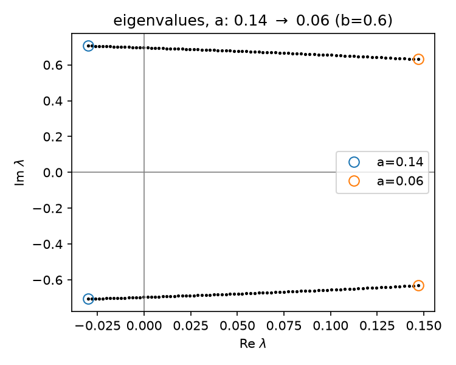
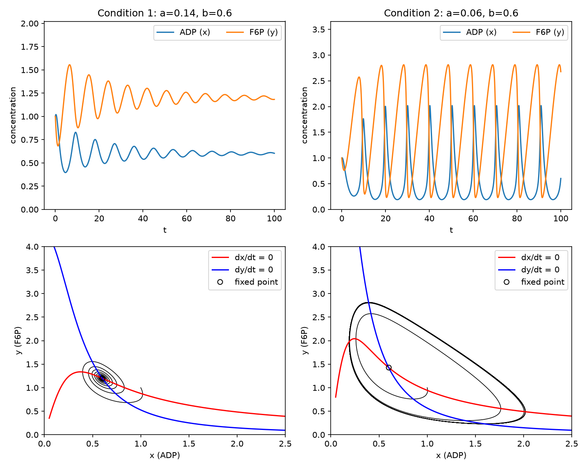
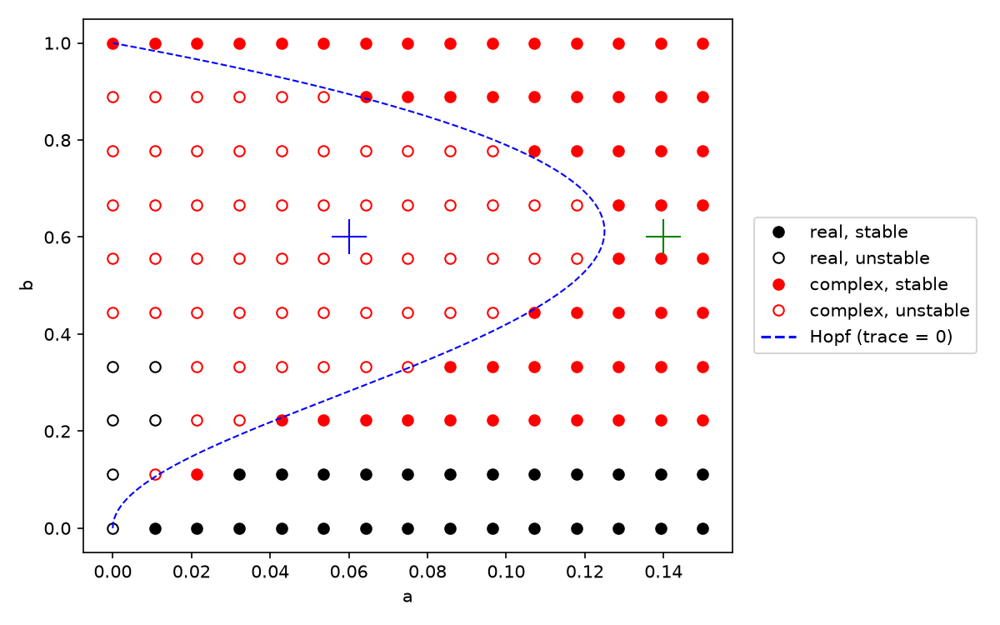

学籍番号 \_\_\_\_\_\_\_\_\_\_\_\_\_\_\_\_\_\_　氏名 \_\_\_\_\_\_\_\_\_\_\_\_\_\_\_\_\_\_\_\_\_\_

第4回の演習7・8と，第5回の演習1〜6-1をまとめる。
数値解は `scipy.integrate.solve_ivp`（RK45，`rtol=1e-9`），記号計算は SymPy で求めた。
第5回の計算は手で行い，`Day5/shannon.py` で検算した。

# 第4回: Sel'kov モデルの Hopf 分岐と相図

## 対象とするモデル

第4回の宿題と同じ Sel'kov モデルを扱う。

$$
\frac{dx}{dt} = -x + a y + x^2 y, \qquad
\frac{dy}{dt} = b - a y - x^2 y
$$

$x$ は ADP，$y$ は F6P の濃度である。
固定点は $(x^*, y^*) = \left(b,\ \dfrac{b}{a + b^2}\right)$ の 1 つだけで，そこでのヤコビ行列は次のようになる（`selkov_hopf.py` の SymPy 出力と同じ）。

$$
J^* = \begin{pmatrix} \dfrac{b^2 - a}{a + b^2} & a + b^2 \\[2mm] -\dfrac{2b^2}{a + b^2} & -(a + b^2) \end{pmatrix}, \qquad
\tau = \operatorname{tr} J^* = \frac{b^2 - a}{a + b^2} - (a + b^2), \qquad
\Delta = \det J^* = a + b^2
$$

固有値は $\lambda = \dfrac{\tau}{2} \pm \sqrt{\dfrac{\tau^2}{4} - \Delta}$ である。

## 演習7: Sel'kov モデルと Hopf 分岐

### 1. 固有値から Hopf 分岐を示す

2 つの条件で $\tau$，$\Delta$，固有値を求めた。

| | $a$ | $b$ | $\tau$ | $\Delta$ | $\tau^2 - 4\Delta$ | 固有値 $\lambda$ | 分類 |
|-----|----|----|------|-----|------|-------------|---------------|
| 条件1 | 0.14 | 0.6 | $-0.0600$ | $0.500$ | $-1.996$ | $-0.0300 \pm 0.7065i$ | 安定なスパイラル |
| 条件2 | 0.06 | 0.6 | $0.2943$ | $0.420$ | $-1.593$ | $0.1471 \pm 0.6311i$ | 不安定なスパイラル |

- どちらの条件でも $\tau^2 - 4\Delta < 0$ なので，固有値は互いに共役な複素数である。
- 実部 $\tau/2$ は，条件1で負（複素平面の左半平面），条件2で正（右半平面）である。
- $a$ を 0.14 から 0.06 へ連続に下げると，$\Delta \geq 0.42$，$|\tau| \leq 0.30$ なので途中でもずっと $\tau^2 - 4\Delta < 0$ のままである。共役な複素固有値の組が，実部の符号を負から正へ変えながら動く（図1）。

実部が 0 になる点は $\tau = 0$ から求まる。$s = a + b^2$ とおくと $\tau = 0$ は $s^2 + s - 2b^2 = 0$ になり，

$$
a = \frac{\sqrt{1 + 8b^2} - 1}{2} - b^2
$$

である。$b = 0.6$ では $a_H = 0.1249$ で，このとき固有値は $\pm 0.696i$（純虚数）になる。
$a_H$ は条件1（$a = 0.14$）と条件2（$a = 0.06$）の間にある。

したがって，条件1から条件2へ $a$ を下げると，共役な複素固有値が $a = a_H$ で虚軸を左から右へ横切る。
これは講義の Hopf 分岐の定義にあてはまり，安定なスパイラルが不安定なスパイラルに変わる。

{width=55%}

### 2. 振動が持続するかのシミュレーション

`selkov_hopf.py` で，初期値 $(x, y) = (1.0, 1.0)$ から $t = 0$〜$100$ を解いた（図2）。
上段は時系列，下段は相平面上の軌道とヌルクライン（赤: $dx/dt = 0$，青: $dy/dt = 0$）である。

{width=95%}

同じ条件で $t = 300$ まで解き，ADP（$x$）の振れ幅（最大値 − 最小値）を区間ごとに測ると次のようになった。

| 区間 | 条件1（$a = 0.14$） | 条件2（$a = 0.06$） |
|---|---|---|
| $t = 0$〜$20$ | 0.623 | 1.810 |
| $t = 80$〜$100$ | 0.035 | 1.828 |
| $t = 280$〜$300$ | 0.0001 | 1.828 |

- **条件1: 振動は持続しない。** 振れ幅が小さくなり続け，固定点 $(0.6, 1.2)$ に巻き込みながら近づく減衰振動である。ピークの間隔は 8.89 で，固有値の虚部から予想される周期 $2\pi/0.7065 = 8.89$ と一致する。
- **条件2: 振動は持続する。** 振れ幅は $t = 80$ 以降一定で，ADP は 0.191〜2.018，F6P は 0.230〜2.813 を周期 10.16 で回り続ける。固定点が不安定なスパイラルなので解は固定点から離れるが，発散せずにリミットサイクルに落ち着く（第4回の宿題と同じ閉じた軌道）。

固有値の実部が負の条件1では振動が消え，正の条件2では振動が持続する。演習7-1 で示した Hopf 分岐をはさんで挙動が変わることが，シミュレーションでも確かめられた。

## 演習8: Sel'kov モデルの相図

配布された `selkov_phase_diagram.py` の空欄は次のように埋めた。
2 つの固有値は互いに共役か，ともに実数なので，`eig1` だけを見れば実数か複素数かが分かる。

```python
for a_val , b_val in zip( A.flatten() , B.flatten() ):
    J_num = J_sym.subs( [ ( x , fix_x ) , ( y , fix_y ) , ( a , a_val ), ( b , b_val ) ] )
    eig1, eig2 = J_num.eigenvals().keys()

    if eig1.is_real : # eig1 が実数ならば if 節に入る
        if eig1 < 0 and eig2 < 0 : # 実数・安定
            plt.plot( a_val , b_val , 'ko' )
        else : # 実数・不安定
            plt.plot( a_val , b_val , 'ko' , fillstyle='none')
    else :
        if re( eig1 ) < 0 : # eig1 の実部が負であれば if 節に入る。すなわち複素数・安定の場合。
            plt.plot( a_val , b_val , 'ro' )
        else : # 複素数・不安定
            plt.plot( a_val , b_val , 'ro' , fillstyle='none')
```

このほか，図を保存する `savefig` と凡例を足した。
演習7-1 の $\tau = 0$ の式を SymPy で $a$ について解き，Hopf 分岐が起きる曲線として破線で重ねた（図3）。
青の + は条件2（$a = 0.06$，$b = 0.6$），緑の + は条件1（$a = 0.14$，$b = 0.6$）である。

{width=80%}

相図から次のことが読み取れる。

- **複素数・不安定（白抜きの赤）** の点は破線の内側に集まっている。ここでは固定点が不安定なスパイラルで，演習7の条件2と同じく振動が持続する。条件2（青の +）はこの領域にある。
- 破線の外側（$a$ が大きい側）は，下の 2 行を除いて **複素数・安定（塗りの赤）** で，減衰振動して固定点に落ち着く。条件1（緑の +）はこの領域にある。白抜きと塗りの赤の境目を破線が通っており，この曲線上で Hopf 分岐が起きる。
- 破線の $a$ は $b^2 = 3/8$（$b \approx 0.61$）で最大値 $1/8 = 0.125$ をとる。$a > 0.125$ ではどの $b$ でも振動は持続しない。
- $b$ が小さい下の 2 行はおおむね **実数・安定（塗りの黒）** で，振動せずに固定点に近づく。$b = 0$ の行は固定点が $(0, 0)$ で，固有値は $-1$ と $-a$ である。
- $a = 0$ の列で $b \leq 0.33$ の点は **実数・不安定（白抜きの黒）** である。$a = 0$ では $\tau = 1 - b^2 > 0$，$\Delta = b^2$ なので，$b < \sqrt{2} - 1 \approx 0.41$ で固有値が正の実数 2 つになる。

なお，格子点 $(a, b) = (0, 1)$ はちょうど破線の上にあり，固有値は $\pm i$（純虚数）である。
SymPy の浮動小数点計算で実部が $-1.5 \times 10^{-64}$ になるため「複素数・安定」に分類されたが，実際には安定と不安定の境目である。
$(a, b) = (0, 0)$ も，$a = b = 0$ では固定点が 1 点に決まらない（$x = 0$ の直線全体が固定点になる）ため，分類に意味がない。
講義の完成図も同じ表示になっている。

# 第5回: bit 単位で測る情報伝達

8 細胞の ERK と CREB の蛍光強度（演習1の表）を使う。
区間は ERK が 0–1，1–2，2–3，CREB が 0–10，10–20，20–30 である。区間の境目にちょうど乗る値はない。

## 演習1: 度数分布表

各細胞を区間に振り分けた。

| ERK＼CREB | 0–10 | 10–20 | 20–30 |
|---|---|---|---|
| 0–1 | Cell 1, 6 | Cell 4 | — |
| 1–2 | Cell 3 | Cell 2, 7 | Cell 8 |
| 2–3 | — | — | Cell 5 |

度数分布表は次のとおり（講義の表と同じく，縦軸 CREB を上ほど大きく並べた）。

| CREB＼ERK | 0–1 | 1–2 | 2–3 |
|---|---|---|---|
| 20–30 | 0 | 1 | 1 |
| 10–20 | 1 | 2 | 0 |
| 0–10 | 2 | 1 | 0 |

合計は 8 で，細胞数と一致する。

## 演習2: 同時分布

各度数を細胞数 8 で割って，相対度数分布 $P(\mathrm{ERK}, \mathrm{CREB})$ を求めた。

| CREB＼ERK | 0–1 | 1–2 | 2–3 |
|---|---|---|---|
| 20–30 | 0 | 1/8 | 1/8 |
| 10–20 | 1/8 | 1/4 | 0 |
| 0–10 | 1/4 | 1/8 | 0 |

総和は $1/4 \times 2 + 1/8 \times 4 = 1$ である。

## 演習3: 周辺分布

同時分布を列ごとに足すと $P(\mathrm{ERK})$，行ごとに足すと $P(\mathrm{CREB})$ になる。

| ERK | 0–1 | 1–2 | 2–3 |
|---|---|---|---|
| $P(\mathrm{ERK})$ | $1/4 + 1/8 + 0 = 3/8$ | $1/8 + 1/4 + 1/8 = 1/2$ | $0 + 0 + 1/8 = 1/8$ |

| CREB | 0–10 | 10–20 | 20–30 |
|---|---|---|---|
| $P(\mathrm{CREB})$ | $1/4 + 1/8 + 0 = 3/8$ | $1/8 + 1/4 + 0 = 3/8$ | $0 + 1/8 + 1/8 = 1/4$ |

どちらも総和は 1 である。

## 演習4: 情報量

$I = -\log_2 P$ に周辺分布を代入した。数値は $\log_2 3 = 1.6$ として求め，括弧内に正確な値を書いた。

| CREB | $P(\mathrm{CREB})$ | $I(\mathrm{CREB})$ (bit) |
|---|---|---|
| 0–10 | 3/8 | $-\log_2 \frac{3}{8} = 3 - \log_2 3 = 1.4$（1.415） |
| 10–20 | 3/8 | $-\log_2 \frac{3}{8} = 1.4$（1.415） |
| 20–30 | 1/4 | $-\log_2 \frac{1}{4} = 2$ |

| ERK | 0–1 | 1–2 | 2–3 |
|---|---|---|---|
| $P(\mathrm{ERK})$ | 3/8 | 1/2 | 1/8 |
| $I(\mathrm{ERK})$ (bit) | $-\log_2 \frac{3}{8} = 1.4$（1.415） | $-\log_2 \frac{1}{2} = 1$ | $-\log_2 \frac{1}{8} = 3$ |

確率の小さい区間ほど情報量が大きい（ERK 2–3 は 8 細胞中 1 細胞だけなので 3 bit）。

## 演習5-1: シャノンエントロピー

$H = \sum_i P_i\, I_i$ に演習3・4の値を代入した。

$$
\begin{aligned}
H(\mathrm{CREB}) &= \tfrac{3}{8} \times 1.4 + \tfrac{3}{8} \times 1.4 + \tfrac{1}{4} \times 2 = 0.525 + 0.525 + 0.5 = 1.55\ \text{bit} \\
H(\mathrm{ERK}) &= \tfrac{3}{8} \times 1.4 + \tfrac{1}{2} \times 1 + \tfrac{1}{8} \times 3 = 0.525 + 0.5 + 0.375 = 1.40\ \text{bit}
\end{aligned}
$$

正確な値は $H(\mathrm{CREB}) = \frac{11}{4} - \frac{3}{4}\log_2 3 = 1.561$ bit，$H(\mathrm{ERK}) = 2 - \frac{3}{8}\log_2 3 = 1.406$ bit である。

## 演習5-2: 同時分布のシャノンエントロピー

演習2・3の同時分布を $H(\mathrm{ERK}, \mathrm{CREB}) = \sum_i \sum_j P \log_2 \frac{1}{P}$ に代入した。
$P = 0$ のマスは $\lim_{P \to 0} P \log_2 \frac{1}{P} = 0$ なので足さない。
残るのは $P = 1/4$ のマスが 2 つ，$P = 1/8$ のマスが 4 つである。

$$
H(\mathrm{ERK}, \mathrm{CREB}) = 2 \times \tfrac{1}{4}\log_2 4 + 4 \times \tfrac{1}{8}\log_2 8 = 2 \times 0.5 + 4 \times 0.375 = 2.5\ \text{bit}
$$

$\log_2 3$ を含まないので，これは近似なしの値である。

## 演習6-1: 相互情報量

$$
I(\mathrm{CREB}; \mathrm{ERK}) = H(\mathrm{CREB}) + H(\mathrm{ERK}) - H(\mathrm{ERK}, \mathrm{CREB}) = 1.55 + 1.40 - 2.5 = 0.45\ \text{bit}
$$

正確な値は $\frac{9}{4} - \frac{9}{8}\log_2 3 = 0.467$ bit である。

相互情報量が 0 より大きいので，ERK の値を知ると CREB の値の不確かさが減る。
ただし 1 bit（2 状態）には届かず，下流の CREB で区別できる状態は $2^{0.45} \approx 1.4$ 個分にとどまる。
8 細胞・3×3 の区間で見積もった値であり，細胞数が少ないと相互情報量は実際より大きめに出やすい点に注意が要る。
