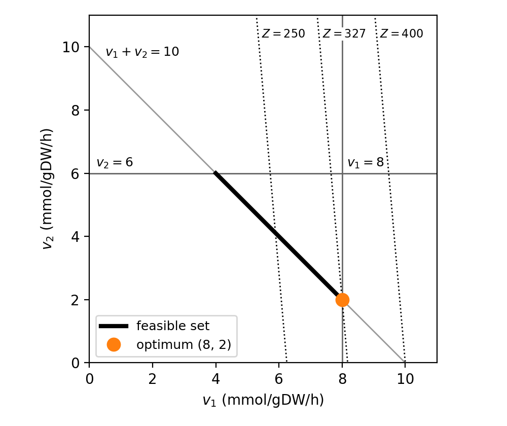
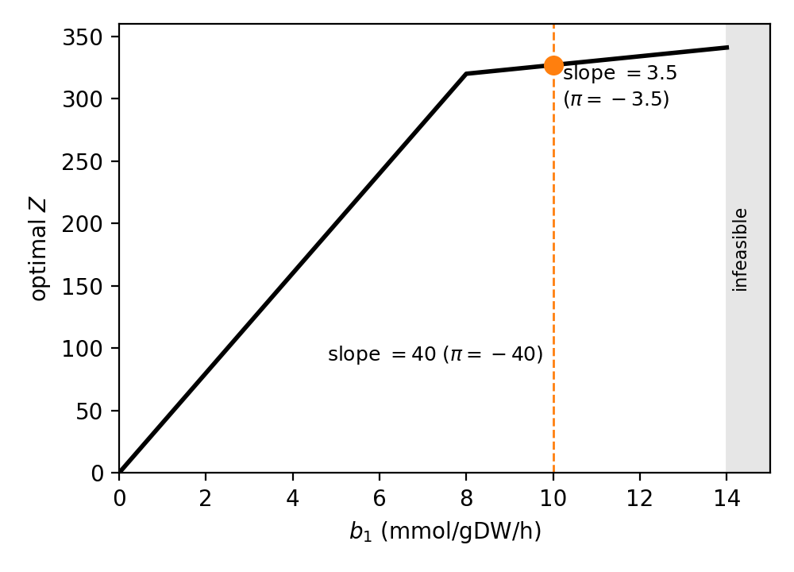

学籍番号 \_\_\_\_\_\_\_\_\_\_\_\_\_\_\_\_\_\_　氏名 \_\_\_\_\_\_\_\_\_\_\_\_\_\_\_\_\_\_\_\_\_\_

第6回の演習1〜4をまとめる。
計算は手で行い，零空間は SymPy，線形計画問題は `scipy.optimize.linprog`（HiGHS 法）で検算した（`Day6/fba.py`）。
流束の単位はすべて mmol/gDW/h である。

# 演習1: 化学量論係数行列

図の経路の反応は次の 6 つである。
$v_1$ と $v_4$ は外界との出入りなので，片側にしか物質がない。

$$
v_1: \ \to S_1, \quad v_2: S_1 \to S_2, \quad v_3: S_2 \to S_4, \quad
v_4: S_4 \to, \quad v_5: S_1 \to S_3, \quad v_6: S_3 \to S_4
$$

行を代謝物質，列を反応とし，反応で消費される物質に $-1$，生成される物質に $+1$ を書く。

$$
\begin{array}{c|rrrrrr}
 & v_1 & v_2 & v_3 & v_4 & v_5 & v_6 \\ \hline
S_1 & 1 & -1 & 0 & 0 & -1 & 0 \\
S_2 & 0 & 1 & -1 & 0 & 0 & 0 \\
S_3 & 0 & 0 & 0 & 0 & 1 & -1 \\
S_4 & 0 & 0 & 1 & -1 & 0 & 1
\end{array}
\qquad\Longrightarrow\qquad
N = \begin{pmatrix}
1 & -1 & 0 & 0 & -1 & 0 \\
0 & 1 & -1 & 0 & 0 & 0 \\
0 & 0 & 0 & 0 & 1 & -1 \\
0 & 0 & 1 & -1 & 0 & 1
\end{pmatrix}
$$

**参考（零空間）**　$\operatorname{rank} N = 4$ なので，零空間 $K$ の列数は $6 - 4 = 2$ である。
上の経路（$S_1 \to S_2 \to S_4$）と下の経路（$S_1 \to S_3 \to S_4$）を 1 本ずつ流す流束が基底になる。

$$
K = \begin{pmatrix} 1 & 1 & 1 & 1 & 0 & 0 \\ 1 & 0 & 0 & 1 & 1 & 1 \end{pmatrix}^{\mathsf T}, \qquad NK = O
$$

定常状態の流束は $v = \alpha\,(1,1,1,1,0,0)^{\mathsf T} + \beta\,(1,0,0,1,1,1)^{\mathsf T}$ と書け，$v_1 = v_4 = \alpha + \beta$，$v_2 = v_3 = \alpha$，$v_5 = v_6 = \beta$ となる。
分岐点 $S_1$ での流入が 2 つの経路に分かれ，$S_4$ で合流することに対応する。
SymPy の `nullspace()` は 2 本目を $(0,-1,-1,0,1,1)^{\mathsf T}$ と返すが，これは上の 2 本の差で，同じ空間を張る。

# 演習2: 零空間

$N = (1\ 1\ 1)$ で，3 つの反応はすべて $S$ を生成する。
$\operatorname{rank} N = 1$ なので，$K$ の列数は $3 - 1 = 2$ である。

$Nk = 0$ は $k_1 + k_2 + k_3 = 0$ と同じである。
$k_2 = -s$，$k_3 = -t$ を自由に選ぶと $k_1 = s + t$ と決まるので，

$$
k = s \begin{pmatrix} 1 \\ -1 \\ 0 \end{pmatrix} + t \begin{pmatrix} 1 \\ 0 \\ -1 \end{pmatrix}, \qquad
K = \begin{pmatrix} 1 & 1 \\ -1 & 0 \\ 0 & -1 \end{pmatrix}, \qquad
NK = (0\ \ 0)
$$

となる。$K$ の 2 列は線形独立なので，零空間の基底である。
零空間は $(1, 1, 1)^{\mathsf T}$ に直交する平面で，基底の選び方は一意でない。
`scipy.linalg.null_space` は同じ平面の正規直交基底を返し，上の $K$ の列はその線形結合で書ける。

$K$ のどの列にも負の成分がある。
3 つの反応がすべて不可逆（$v_i \geq 0$）なら，定常状態は $v = 0$ しかない。
0 でない定常流束には，どれかの反応が逆向きに進んで $S$ を消費する必要がある。
たとえば 1 列目は，$v_1$ で生成した $S$ を $v_2$ の逆反応で同じ速さだけ消費する状態である。

# 演習3: 線形計画法による最適流束分布

経路は $b_1: \ \to A$，$v_1: A \to B$（ATP を合成），$v_2: A \to B$（NADH を合成），$b_2: B \to$ である。
$A$ と $B$ の定常条件は

$$
A: \ b_1 - v_1 - v_2 = 0, \qquad B: \ v_1 + v_2 - b_2 = 0
$$

で，$b_1 = b_2 = 10$ からどちらも $v_1 + v_2 = 10$ になる。
解く線形計画問題は次のとおりである（$v_{\mathrm{ATP}} = v_1$，$v_{\mathrm{NADH}} = v_2$）。

$$
\max_{v_1, v_2} \ Z = 40 v_1 + 3.5 v_2 \qquad
\text{s.t.} \quad v_1 + v_2 = 10, \quad 0 \leq v_1 \leq 8, \quad 0 \leq v_2 \leq 6
$$

**実行可能領域**　$v_2 = 10 - v_1 \leq 6$ から $v_1 \geq 4$，$v_1 \leq 8$ から $v_2 \geq 2$ なので，
実行可能領域は直線 $v_1 + v_2 = 10$ 上の点 $(4, 6)$ と $(8, 2)$ を結ぶ線分である（図1の太線）。

**最適解**　線分上では $v_2 = 10 - v_1$ なので

$$
Z = 40 v_1 + 3.5\,(10 - v_1) = 35 + 36.5\, v_1
$$

となり，$Z$ は $v_1$ について単調に増える。したがって $v_1$ を上限まで使う点が最適である。

$$
v_1 = 8, \qquad v_2 = 2, \qquad Z = 40 \times 8 + 3.5 \times 2 = 327
$$

図的には，$Z$ の等高線の傾き $-40/3.5 \approx -11.4$ が制約の直線の傾き $-1$ より急なので，
等高線を右へ動かしていくと最後に触れるのは $v_1$ が最大の端点 $(8, 2)$ である。
$A$ 1 単位あたりの $Z$ への寄与は ATP 経路が 40，NADH 経路が 3.5 なので，ATP 経路を上限まで使い，残りを NADH 経路に回すのが最適である。
`linprog` でも $v_1 = 8$，$v_2 = 2$，$b_2 = 10$，$Z = 327$ が得られた。

{width=55%}

`linprog` は最小化しか扱わないので，$-Z$ を最小化した。
変数は $(v_1, v_2, b_2)$ とし，$b_1$ は右辺に置いて演習4でその双対値を読む。
$b_2$ は変数にして $B$ の定常条件で決める。

```python
def solve_fba(b1: float) -> OptimizeResult:
    c = [-Z_COEF[0], -Z_COEF[1], 0.0]  # linprog は最小化なので -Z
    a_eq = [[1.0, 1.0, 0.0],    # A: v1 + v2 = b1
            [1.0, 1.0, -1.0]]   # B: v1 + v2 - b2 = 0
    bounds = [(0.0, V_MAX[0]), (0.0, V_MAX[1]), (0.0, None)]
    return linprog(c, A_eq=a_eq, b_eq=[b1, 0.0], bounds=bounds, method='highs')
```

# 演習4: 流入量 $b_1$ に対する Shadow Price

講義の定義は $\pi_i = -\dfrac{\partial Z}{\partial b_i}$ である。

$b_1$ を 10 から少し動かす。$b_2$ は $B$ の定常条件から $b_2 = b_1$ に追従させる
（$b_2 = 10$ に固定したまま $b_1$ だけ動かすと，$v_1 + v_2 = b_1$ と $v_1 + v_2 = 10$ が両立しない）。
最適解では $v_1$ が上限 8 に張り付いているので，増えた $A$ はすべて $v_2$ に流れる。
$v_2 = b_1 - 8$ が $0 \leq v_2 \leq 6$ を満たす $8 \leq b_1 \leq 14$ では，最適値は

$$
Z^*(b_1) = 40 \times 8 + 3.5\,(b_1 - 8) = 292 + 3.5\, b_1
$$

となる。したがって

$$
\frac{\partial Z}{\partial b_1} = 3.5, \qquad
\pi_{b_1} = -\frac{\partial Z}{\partial b_1} = -3.5
$$

である（$b_1$ が 1 mmol/gDW/h 増えると $Z$ が 3.5 増える）。

- Shadow price が負なので，$A$ は増殖に役立つ物質である。講義の「Shadow price が負の物質は増殖に役立つので分泌しない」に合う。
- 値が NADH の係数 3.5 と等しいのは，ATP 経路が上限に達しており，追加の $A$ は NADH 経路でしか使えないからである。
- この値は $8 < b_1 < 14$ でだけ成り立つ（図2）。$b_1 < 8$ では追加の $A$ が ATP 経路に流れるので $\pi_{b_1} = -40$ になる。$b_1 > 14$ は 2 経路の上限の和を超えるので，$b_1$ を固定した問題は実行不能になる。

`linprog` の結果でも，$A$ の定常条件の双対値（`res.eqlin.marginals[0]` $= \partial(-Z)/\partial b_1$）は $-3.5$ だった。
これは講義の $\pi_{b_1}$ そのものである。
$b_1 = 9.5$ と $10.5$ の最適値の差から求めた $-\partial Z / \partial b_1$ も $-3.5$ で一致した。

{width=60%}

**参考（上限の感受性）**　同じ計算で，$v_1$ の上限 8 を 1 上げると $Z$ は 36.5（$= 40 - 3.5$）増え，$v_2$ の上限 6 を上げても $Z$ は変わらない。
ATP 経路の酵素を増やすと増殖が速くなるが，NADH 経路の酵素を増やしても増殖は変わらない。
